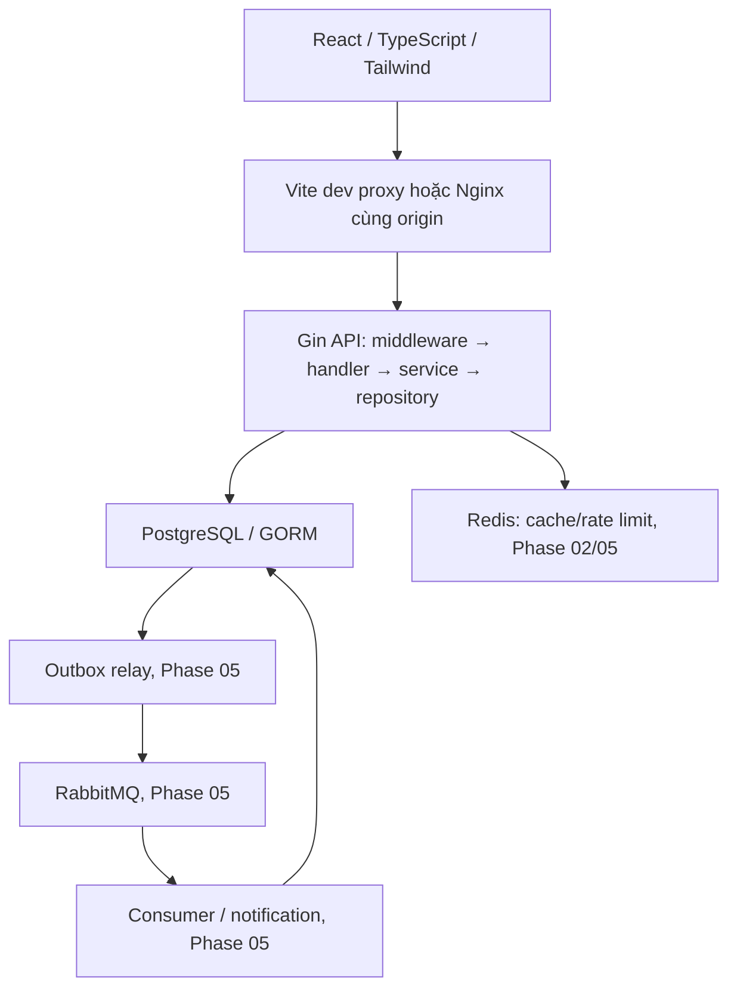

# Kiến trúc E-commerce Base

## Thành phần và ranh giới

`was/cmd/api`, `was/cmd/worker`, `was/cmd/migrate`, `was/cmd/seed` là composition root. Config/database/HTTP/runtime dùng chung nhưng không chứa logic giỏ hàng/đơn hàng. Module mới nằm ở `was/internal/modules/<domain>/` khi phase của nó bắt đầu; không tạo hàng loạt repository/service rỗng.

Mỗi module sở hữu bảng và service của mình. Orders điều phối transaction bằng handle DB chung, gọi inventory/payment/coupon với cùng transaction; không gọi HTTP nội bộ, không ghi thẳng bảng module khác từ handler. Các interface chỉ thêm ở boundary có nhu cầu kiểm thử hoặc thay thế thật.

## Phase 01 thực sự cung cấp

- Liveness `/health/live`, readiness `/health/ready` kiểm DB/schema/seed.
- `/api/v1/foundation` đọc cấu hình cửa hàng thật từ PostgreSQL, trả trạng thái nền tảng.
- `/openapi.json` cung cấp contract hợp lệ, gồm endpoint hiện thực và tương lai có đánh dấu.
- React hiển thị kết nối thật, lỗi/mất kết nối và nút kiểm tra lại. Swagger UI được bundle local ở `/api-docs/index.html`, không phụ thuộc CDN.
- Worker bootstrap DB/schema rồi chờ SIGTERM; chưa đăng ký consumer, chưa xử lý notification.

## Khởi chạy, context và lỗi

Migration service chạy riêng rồi seed service. API chỉ ready khi schema version đúng, không dirty và store settings đã seed. Liveness không gọi DB. DB lỗi sau startup làm readiness và foundation lỗi; process còn sống để phục hồi.

HTTP có read-header/read/write/idle timeout, giới hạn body, request ID, security headers, request log cấu trúc và recovery không lộ stack trace. Context timeout truyền vào GORM. Shutdown nhận SIGINT/SIGTERM, ngừng listener, drain request rồi đóng pool DB. Nếu vượt shutdown timeout, buộc đóng và ghi lỗi.

Frontend dùng cùng origin; dev proxy/Nginx chuyển `/api`, `/health`, `/openapi.json`. Backend CORS allowlist chính xác cho trường hợp gọi trực tiếp; không wildcard credentials. Không có auth secret trong Phase 01 vì chưa auth.

## Các lỗi thiết kế đã xử lý

- Không dùng Redis cho stock hoặc idempotency giao dịch.
- Không publish broker trước/sau commit mà thiếu outbox.
- Không coi attempt Failed là order Failed; xem [state machine](order-payment-state-machine.md).
- Không trả thông tin DSN/SQL/panic cho client; log bootstrap chỉ có thông tin lỗi đã làm sạch.
- Không tự migrate trong API hoặc seed phá dữ liệu mỗi lần restart.

## Tài liệu liên quan

[ERD](erd.md), [API](api-design.md), [event contract](events.md), [quyết định](architecture-decisions.md), [requirements](requirements.md), [tiến độ](PROGRESS.md).

## Bố trí repository

Backend nằm hoàn toàn trong `was/` với module Go riêng. `was/api/openapi.yaml` là nguồn chuẩn contract, được embed qua `was/api/embed.go` vào API binary. Frontend nằm trong `viewer/`, chỉ đọc contract này để sinh TypeScript; không phụ thuộc package Go hoặc tài liệu Markdown khi build. Docs/plans ở root dùng chung và không nằm trong module Go.

Root Makefile gọi `make -C was` và `npm --prefix viewer`. Runner E2E ở root dùng binary `was/bin/` và Vite từ `viewer/`. Backend test runner ở `was/scripts/`. Dockerfile backend dùng context `was/`; Dockerfile viewer dùng context root để lấy contract `was/api/`. Kiểm chứng Docker đang được hoãn theo yêu cầu người dùng.
