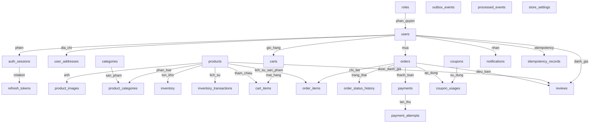

# ERD và dữ liệu tổng thể

Nền Phase 02 có 13 bảng ứng dụng gồm `store_settings`, `roles`, `users`, `auth_sessions`, `refresh_tokens`, `user_addresses`, `categories`, `products`, `product_images`, `product_categories`, `inventory`, `inventory_transactions`, `idempotency_records`. `schema_migrations` do golang-migrate quản lý riêng. Phase 03 bổ sung carts/cart_items/orders/order_items/order_status_history/payments/payment_attempts/outbox_events, nâng tổng lên 21 bảng ứng dụng. Coupon/review/notification/processed_events vẫn là thiết kế Phase 04–05, chưa tạo.

Nguồn chuẩn của schema hiện tại: [migration 1](../was/migrations/000001_store_settings.up.sql) , [migration 2](../was/migrations/000002_identity_catalog_inventory.up.sql) và [migration 3](../was/migrations/000003_cart_orders_payments.up.sql).

## Từ điển dữ liệu

| Bảng | Trường/ràng buộc chính |
| --- | --- |
| `users` | id uuid PK; email text UNIQUE đã lower/trim; name/password_hash text; role_id uuid FK roles; status Active/Disabled; session_version bigint; deleted_at/created_at/updated_at timestamptz |
| `roles` | id uuid PK; code text UNIQUE Customer/Admin |
| `auth_sessions` | id uuid PK (family); user_id uuid FK; user_version bigint; expires_at/revoked_at/created_at timestamptz |
| `refresh_tokens` | id uuid PK; family_id uuid FK auth_sessions; token_hash text UNIQUE; expires_at/used_at/created_at timestamptz; replaced_by uuid FK refresh_tokens |
| `user_addresses` | id uuid PK; user_id uuid FK; recipient/phone/address text; is_default boolean |
| `products` | id uuid PK; sku text UNIQUE; name/description text; price_minor bigint CHECK 0..9×10¹²; original_price_minor bigint CHECK 0..9×10¹²; status text; version bigint; deleted_at timestamptz |
| `product_images` | id uuid PK; product_id uuid FK; url text; sort_order int; alt text |
| `categories` | id uuid PK; name text; slug text UNIQUE; deleted_at timestamptz |
| `product_categories` | product_id/category_id uuid composite PK/FK |
| `inventory` | product_id uuid PK/FK; quantity bigint CHECK 0..9×10¹²; version bigint |
| `inventory_transactions` | id uuid PK; product_id uuid FK; actor_id uuid nullable FK; delta/before_quantity/after_quantity bigint CHECK after_quantity=before_quantity+delta; reason/reference text; UNIQUE product_id/reason/reference |
| `carts` | id uuid PK; user_id uuid UNIQUE FK; version bigint |
| `cart_items` | id uuid PK; cart_id/product_id uuid FK; quantity bigint CHECK 1..1000; UNIQUE cart_id/product_id |
| `orders` | id uuid PK; user_id uuid FK; status text; subtotal_minor/discount_minor/shipping_minor/total_minor bigint CHECK 0..9×10¹² và tổng đúng công thức; discount_minor=0; currency VND; shipping_address jsonb; version bigint |
| `order_items` | id uuid PK; order_id/product_id uuid FK; sku/name/image_url text; quantity bigint CHECK 1..1000; unit_price_minor/line_total_minor bigint CHECK 0..9×10¹² và line_total_minor=quantity×unit_price_minor |
| `order_status_history` | id uuid PK; order_id uuid FK; from_status/to_status text; actor_id uuid nullable FK; reason text; created_at timestamptz |
| `payments` | id uuid PK; order_id uuid UNIQUE FK; method/status text; amount_minor bigint CHECK 0..9×10¹²; paid_at timestamptz |
| `payment_attempts` | id uuid PK; payment_id uuid FK; status text; failure_code text; UNIQUE partial payment_id WHERE status=Paid; UNIQUE partial payment_id WHERE status=Pending |
| `coupons` | id uuid PK; code text UNIQUE; kind text; value/minimum bigint CHECK >=0; expires_at timestamptz; usage_limit/used_count bigint; enabled boolean; CHECK used_count<=usage_limit |
| `coupon_usages` | id uuid PK; coupon_id/user_id uuid FK; order_id uuid UNIQUE FK; discount bigint |
| `reviews` | id uuid PK; user_id/product_id/order_id uuid FK; rating int CHECK 1..5; content text; visibility text; deleted_at timestamptz; UNIQUE user_id/product_id |
| `notifications` | id uuid PK; user_id uuid FK; event_id uuid; kind/title/body text; read_at timestamptz; UNIQUE user_id/event_id/kind |
| `outbox_events` | id uuid PK; aggregate_id uuid; aggregate_type/type text; version int; aggregate_version bigint; correlation_id text; payload jsonb; occurred_at/published_at/lease_until timestamptz; attempts int |
| `processed_events` | consumer text/event_id uuid composite PK; processed_at timestamptz |
| `idempotency_records` | id uuid PK; actor_id uuid FK users; operation/key text composite UNIQUE; payload_hash text; response_status int; response_body jsonb; created_at timestamptz |
| `store_settings` | id boolean PK CHECK true; name text; currency text CHECK VND; shipping_fee_minor bigint CHECK >=0; updated_at timestamptz |

## Quy tắc dữ liệu và index

- Entity nghiệp vụ có created_at/updated_at UTC trừ bảng append-only chỉ cần created_at. ID UUID sinh phía server. Không hard delete entity đã liên kết order/payment/history.
- Index truy vấn: users(email), products(status, created_at, id), categories(slug), inventory_transactions(product_id, created_at, id), orders(user_id, created_at, id), orders(status, created_at, id), reviews(product_id, visibility, created_at, id), notifications(user_id, read_at, created_at, id), outbox_events(published_at, lease_until, occurred_at). Kiểm tra bằng query thực tế trước tối ưu.
- Snapshot order giữ nguyên tiền/sku/name/address/shipping/coupon dù bảng gốc thay đổi. Order total = subtotal - discount + shipping; coupon không vượt subtotal. Tiền bigint trong miền Base đã mô tả ở API design.
- Coupon lock bảo vệ used_count/usage_limit; coupon_usages/order unique. Payment partial unique index chặn hai successful attempts. Inventory history reference unique chặn hoàn kho lặp.
- Outbox/processed events/idempotency là dữ liệu kỹ thuật bền. Chưa xóa tự động trong Base; policy retention phải giữ khả năng replay/dedupe.
- FK inventory_transactions.actor_id có thể null cho tác vụ hệ thống; vẫn lưu audit reference. Không FK outbox aggregate vào một bảng duy nhất vì có nhiều loại aggregate.
- Down migration chỉ áp dụng dữ liệu test có guard. Với dữ liệu thật ưu tiên migration bổ sung/khôi phục có đối chiếu, không cascade xóa lịch sử.

## Ràng buộc và khóa đã hiện thực ở Phase 02

- Mỗi user có tối đa một địa chỉ mặc định nhờ partial unique index; sửa mặc định khóa user trước các address. Email và SKU vẫn giữ unique sau soft-delete để tránh tái sử dụng định danh ngoài ý muốn.
- Access token tra `auth_sessions` và `users.session_version`; refresh rotation giữ lịch sử hash, replay thu hồi family. Khóa theo user → session → token. Role/status thay đổi khóa roles.Admin → user để bảo vệ admin cuối cùng.
- Adjustment claim idempotency trước khi khóa inventory; mutation, lịch sử và kết quả commit cùng nhau. Reference là UUID record idempotency để hai actor dùng cùng key không va nhau.
- Product update khóa product rồi thay metadata/images/categories cùng transaction; không sửa quantity qua product API. Category archive dọn assignment trong transaction.
- Stock và tiền trong Phase 02 có trần 9×10¹² để an toàn khi truyền qua số nguyên JavaScript; checkout Phase 03 vẫn cần kiểm tra phép nhân/cộng và tổng.

## Ràng buộc Phase 03

- carts.user_id unique và khóa cart chung giữa mutation/checkout. View quote không lưu giá client vào DB; order_items mới là snapshot bền. ShippingAddressSnapshot chỉ giữ recipient/phone/address, không phụ thuộc địa chỉ còn tồn tại hay không.
- order_status_history append-only ở service; terminal order không thể transition tiếp. payments unique/order; payment_attempts partial unique Pending/Paid; Failed attempt không được mở lại.
- Checkout/release dùng inventory_transactions.reference=order UUID và reason riêng order.checkout/order.release. Row lock order cùng unique reference bảo vệ hoàn đúng một lần. Idempotency admin/customer tách operation.
- outbox_events giữ payload/correlation/version và metadata relay chưa dùng. Down migration chỉ được kiểm chứng trên schema test riêng; không dùng để xóa dữ liệu giao dịch thật.
