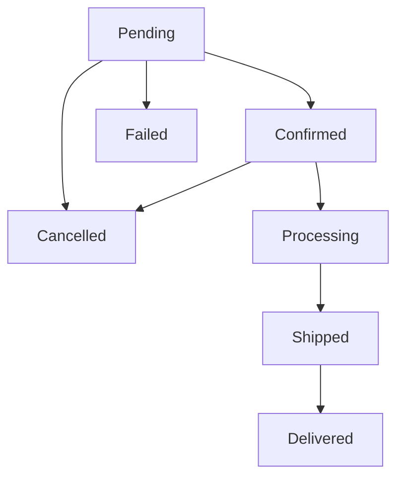

# State machine đơn hàng và thanh toán

Đây là thiết kế cho Phase 03, chưa phải endpoint đã triển khai ở Phase 01.

## Order

| Transition | Actor/điều kiện | Side effect nguyên tử |
| --- | --- | --- |
| Tạo → Pending | Customer, cart/quote/address/stock hợp lệ | Snapshot, giảm stock, payment Pending, outbox, clear cart và idempotent result |
| Pending → Confirmed | Admin với COD; payment service khi mock thành công | Ghi lifecycle history và order.confirmed |
| Confirmed → Processing | Admin; mock phải Paid | History và status-changed event |
| Processing → Shipped | Admin | History và status-changed event |
| Shipped → Delivered | Admin | COD payment Paid và payment.completed; history/status event |
| Pending/Confirmed → Cancelled | Customer sở hữu hoặc Admin; chưa Paid | Hoàn stock một lần, cancel Pending attempt/payment, history/outbox |
| Pending → Failed | Admin, lỗi cuối cùng, chưa Paid | Hoàn stock một lần, cancel payment/attempt Pending, history/outbox |

Cancelled/Failed/Delivered là terminal. Không bỏ bước; transition lặp cùng idempotency key trả kết quả cũ, intent khác không làm side effect thêm.

## Payment aggregate và attempts

Aggregate Pending → Paid hoặc Cancelled. Attempt Pending → Paid/Failed/Cancelled. Attempt Failed giữ bất biến; retry tạo attempt mới, chỉ khi order Pending và chưa Paid. Unique partial index cho một Pending attempt/payment và một Paid attempt/payment. Payment aggregate unique/order.

COD không tạo online attempt. Mock success khóa order/payment, kiểm trạng thái, cập nhật attempt Paid/payment Paid/order Confirmed cùng transaction. Mock failure chỉ đóng attempt, aggregate/order giữ Pending. Callback success sau cancel/Failed bị từ chối. Đơn Paid không hủy trong Base vì chưa có refund.

## Tình huống đồng thời và phục hồi

- Cùng checkout key: claim record unique, giao dịch thứ hai chờ/đọc result; không tạo order mới.
- Cùng cart khác key: khóa cart/version, giao dịch sau thấy cart đã tiêu thụ và trả conflict.
- Payment đua cancel: cả hai khóa order trước; bên sau đọc trạng thái terminal/Paid và từ chối thay đổi trái phép.
- Thiếu một sản phẩm trong checkout nhiều item: rollback toàn bộ stock/order/payment/coupon/outbox.
- Mất response sau commit: replay key trả snapshot response đã lưu, không checkout lại cart.
- Broker down: order và outbox vẫn commit; relay phát lại sau phục hồi, consumer chống trùng.
- Hủy lặp: unique inventory reference theo order/reason cộng row lock ngăn hoàn stock lần hai.
