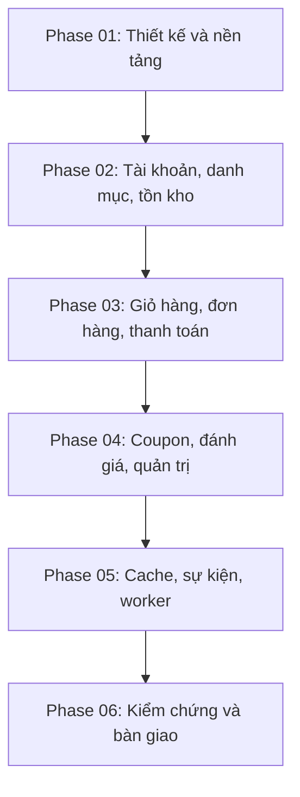
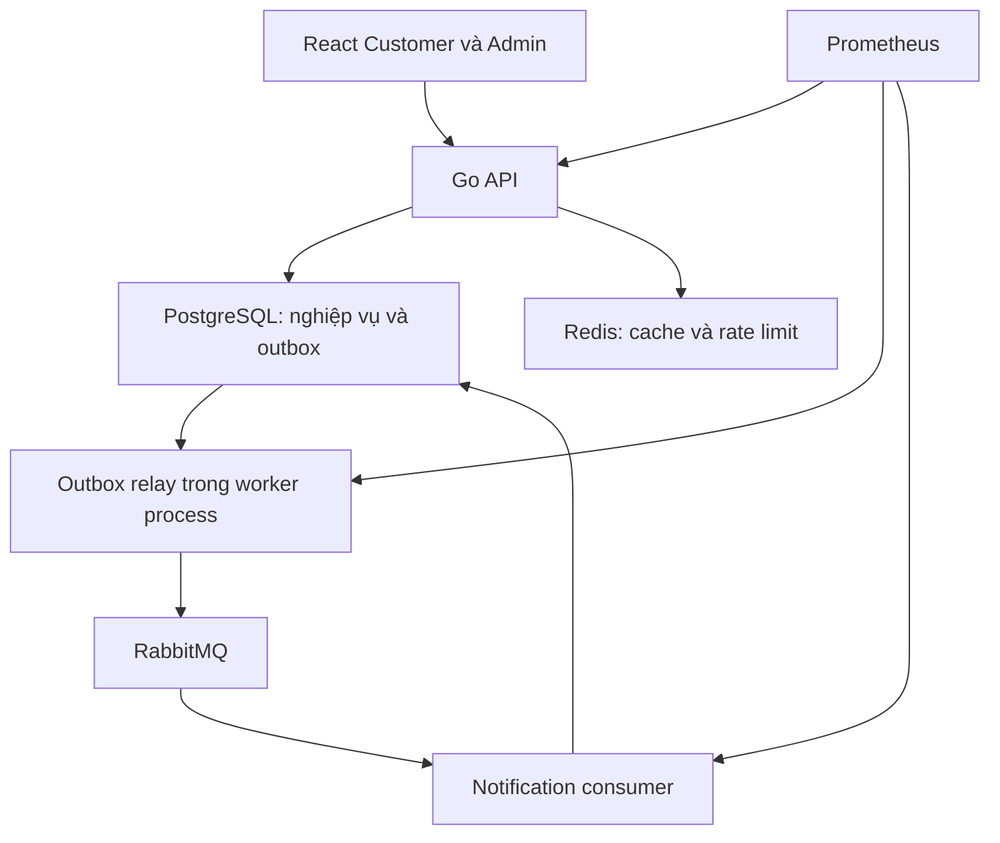

# E-commerce Base — Plan tổng theo phase

## 1. Mục tiêu và cách sử dụng

Xây dựng ứng dụng thương mại điện tử phục vụ đồ án, chạy thật với Go API, React UI, PostgreSQL, Redis, RabbitMQ và background worker. Luồng xuyên suốt: đăng ký → xem sản phẩm → giỏ hàng → đặt hàng → COD/thanh toán mô phỏng → xử lý đơn → lịch sử và thông báo.

Tài liệu này thay thế cấu trúc milestone trong plan nguồn. Bộ tài liệu chỉ chia phase và công việc, không có ước lượng thời gian hoặc lịch triển khai. Mỗi phase có đầu vào, phạm vi, công việc, phụ thuộc, đầu ra và tiêu chí hoàn thành riêng.

Quy ước lưu trữ: thư mục `plans/`, tên file tiếng Anh dạng kebab-case, tiền tố `00` cho plan tổng và `01`–`06` cho các phase; hậu tố `-plan.md` cho mọi file. Tiêu đề và nội dung sử dụng tiếng Việt có dấu.

Tại thời điểm lập plan, repository E-com chỉ có plan nguồn, chưa có mã nguồn, `projects.toml`, Task hay System Design độc lập. Bộ plan fullstack này điều chỉnh template theo yêu cầu của dự án. Owner chưa có trong Git config nên giữ `TBD`; không tạo ticket hoặc trạng thái phê duyệt giả.

Các chỉ dẫn AI trong nguồn được chuyển thành công việc trong plan. Việc chỉnh tài liệu không đồng nghĩa bắt đầu triển khai ứng dụng hoặc thực thi prompt cũ.

## 2. Danh sách phase

| Phase | Plan chi tiết | Kết quả bàn giao | Phụ thuộc |
| --- | --- | --- | --- |
| 01 | [Thiết kế và nền tảng](01-foundation-and-design-plan.md) | Quy tắc nghiệp vụ, ERD, API contract, khung ứng dụng chạy được | Không |
| 02 | [Tài khoản, danh mục và tồn kho](02-identity-catalog-inventory-plan.md) | Auth, user/profile/address, catalog, inventory và UI tương ứng | Phase 01 |
| 03 | [Giỏ hàng, đơn hàng và thanh toán](03-cart-orders-payments-plan.md) | Luồng mua hàng không overselling, không tạo đơn/thanh toán trùng | Phase 02 |
| 04 | [Coupon, đánh giá và quản trị](04-coupons-reviews-admin-plan.md) | Coupon tích hợp checkout, review, moderation và dashboard | Phase 03 |
| 05 | [Cache, sự kiện và worker](05-cache-events-workers-plan.md) | Cache thực tế, RabbitMQ, retry/DLQ, notification và monitoring | Phase 04; nhận outbox từ Phase 03/04 |
| 06 | [Kiểm chứng và bàn giao](06-verification-handover-plan.md) | Kiểm chứng toàn hệ thống, benchmark có evidence, hướng dẫn tái lập | Phase 05 |

Phase 03 là mốc demo mua hàng cốt lõi. Base đầy đủ theo phạm vi nguồn chỉ hoàn thành sau cả sáu phase. Không đánh dấu tính năng chưa tới phase là đã triển khai.

## 3. Kiến trúc và công nghệ giữ lại

- Modular monolith: một Go API chứa module nghiệp vụ; worker là process riêng. Handler → service/usecase → repository; composition root đơn giản; không global mutable state.
- Go, Gin, GORM, PostgreSQL và golang-migrate. Không dùng AutoMigrate thay migration có version.
- React, TypeScript, Tailwind CSS; UI customer/admin kết nối API thật theo từng phase.
- Redis rate limit từ Phase 02; cache product/category ở Phase 05. PostgreSQL lưu cart và mọi trạng thái nghiệp vụ chuẩn.
- RabbitMQ cho xử lý bất đồng bộ ở Phase 05; transaction stock/payment/coupon chạy đồng bộ trong database.
- OpenAPI, Docker Compose, structured logging bằng `slog`, Prometheus và k6.
- Go testing và integration với dịch vụ thật qua môi trường test cô lập hoặc Testcontainers. Phase 01 chọn runner viewer/E2E và khóa phiên bản dependency sau khi kiểm tra khả năng tương thích.

## 4. Quyết định đề xuất cần chốt ở Phase 01

Đây là **phương án đề xuất bổ sung phần thiếu của nguồn**, chưa phải yêu cầu được phê duyệt. Ghi quyết định cuối trong `docs/architecture-decisions.md` trước khi triển khai module liên quan; nếu đổi phải cập nhật các plan bị ảnh hưởng.

| Chủ đề | Phương án đề xuất cho Base |
| --- | --- |
| Sản phẩm | Một SKU/product, nhiều ảnh, chưa có biến thể/nhiều kho/nhiều người bán |
| Tiền và tổng đơn | Một tiền tệ VND, số nguyên đồng, không float; server tính tiền và kiểm tra tràn số |
| Shipping/thuế | Shipping cố định từ cấu hình và snapshot vào order; chưa tích hợp hãng vận chuyển/engine thuế |
| Cart | PostgreSQL lưu theo user; không giữ hàng khi thêm cart; checkout đọc lại giá/trạng thái/stock chuẩn |
| Stock | Trừ stock khi tạo order trong transaction; khóa stock theo thứ tự product ID; hủy hợp lệ hoàn đúng một lần; chưa dùng reservation có hạn |
| Product status | Lưu Draft/Active/Inactive; Out of stock suy ra từ stock bằng 0, không có cờ ghi độc lập |
| Payment | COD và mock; không tiền thật/hoàn tiền online; không cho hủy đơn mock đã Paid |
| Coupon | Một coupon/order; kiểm tra và ghi usage trong transaction checkout; không hoàn lượt dùng khi hủy |
| Review | Phải có order Delivered chứa product; một review/customer/product; moderation ẩn/hiện |
| Ảnh | Lưu metadata và URL; upload file chưa thuộc Base. Nếu bổ sung upload phải có plan giới hạn loại/kích thước/quyền |
| Idempotency | Checkout, payment, cancel và adjustment có khóa theo actor/operation; cùng key/cùng payload trả kết quả cũ, khác payload trả xung đột |
| Sự kiện | Transactional outbox, at-least-once, consumer chống trùng; không dùng broker thay transaction |

## 5. Phân bổ phạm vi nguồn

| Nhóm yêu cầu | Phase phụ trách |
| --- | --- |
| Architecture, ERD, API, security design | 01; cập nhật mỗi phase |
| Docker, config, health, logging, OpenAPI | 01; hoàn thiện 05/06 |
| Register/login/refresh/logout/change password/RBAC | 02 |
| User CRUD, status, search/pagination, profile/address | 02 |
| Product/category CRUD, images/SKU/prices/status/search/filter/sort/pagination | 02 |
| Stock adjustment và history; chống overselling | 02; transaction/concurrency checkout ở 03 |
| Cart, order/history/detail/cancel/admin transition | 03 |
| COD, mock success/failure, attempts/retry, chống trả tiền trùng | 03 |
| Coupon percentage/fixed/expiry/minimum/usage limit/enable-disable | 04 |
| Review rating/content/eligibility và moderation | 04 |
| Customer UI, admin UI | 02/03/04/05 theo chức năng; không dồn UI về cuối |
| Redis rate limit; product/category cache/invalidation/fallback | 02; 05 |
| Order/payment/inventory events | 03/04 ghi outbox; 05 publish/consume |
| Notification nội bộ, mock email, worker, retry/DLQ/idempotency | 05 |
| Unit/integration/concurrency/E2E/security | Từng phase; 06 tổng hợp hồi quy |
| Prometheus, load test, reports và handover | 05/06 |

## 6. Quy tắc thực hiện và nghiệm thu

1. Đọc plan tổng và plan phase hiện tại; triển khai theo ID `Pxx-nn` và phụ thuộc. Chưa bắt đầu công việc chỉ vì nó được nhắc trong tài liệu nguồn.
2. Mỗi công việc cập nhật `docs/PROGRESS.md` với kết quả, lệnh kiểm tra và evidence. Checkbox trong bộ plan hiện đều chưa đánh dấu.
3. Kiểm thử business logic và tích hợp cùng phase triển khai. Phase 06 chạy tổng hợp, không phải nơi bắt đầu viết test.
4. Cập nhật ERD/OpenAPI/decision log/migration/UI khi đổi contract. Không sửa ngược migration đã áp dụng.
5. Không commit secret. Không log password/token. Seed tài khoản demo dùng cấu hình local và có thể chạy lặp.
6. Không thay nghiệp vụ thật bằng mock để vượt kiểm tra; mock payment là chức năng mô phỏng được xác định rõ. Kiểm tra không chạy được ghi “Chưa kiểm chứng”, không báo pass.
7. Không reset dữ liệu cần giữ để xử lý lỗi. Rollback trên dữ liệu nghiệp vụ cần backup hoặc migration sửa tiến và kiểm tra tính tương thích.
8. Chuyển phase khi tiêu chí phase hiện tại đạt và có evidence; không thêm gate xin phép lặp lại cho thao tác triển khai thông thường.

Base hoàn thành khi toàn stack chạy bằng `docker compose up --build`, các chức năng trong bảng phân bổ được kiểm chứng từ UI/API tới dữ liệu, không overselling/đơn trùng/thanh toán trùng/hoàn kho trùng, recovery hạ tầng đạt và tài liệu khớp mã nguồn bàn giao.

## 7. Review plan nguồn

### 7.1. Phạm vi review

Đã đọc toàn bộ plan nguồn trước khi viết lại và kiểm kê repository E-com. Chưa có mã nguồn, PRD/SRS, Task, ERD, contract hoặc test plan độc lập để đối chiếu. Các tài liệu thiết kế cần thiết được phân vào Phase 01.

Checklist đã dùng: BE Implementation Plan Review Checklist, điều chỉnh cho fullstack, bao gồm phạm vi, phân rã công việc, dependency, API/data/migration, bảo mật, failure handling, verification và rollback. Các gate Task/System Design approved của workspace nguồn và cờ TDD chưa được cấu hình là N/A cho E-com. Không có căn cứ kết luận chất lượng mã nguồn khi repository chưa có mã nguồn.

### 7.2. Findings

| ID / Mức độ | Vị trí nguồn / Nhóm | Vấn đề, bằng chứng và tác động | Đề nghị và vị trí xử lý |
| --- | --- | --- | --- |
| RV-01 / High | §4.7–4.9, §15 / Traceability | Có payment/coupon/review nhưng milestone không phân công rõ; dễ bỏ sót khi nghiệm thu Base | Tách Phase 03/04 và bảng phủ phạm vi |
| RV-02 / High | §4.4–4.7, §10 / Technical Completeness | Có concurrency/retry nhưng thiếu quy tắc transaction/idempotency/hoàn kho/state machine; có thể sinh đơn hoặc stock sai | Thiết kế Phase 01, triển khai và chứng minh Phase 03 |
| RV-03 / High | §8 / Technical Completeness | Có publisher/durability nhưng thiếu cơ chế nối DB commit với publish; có khoảng lỗi mất/trùng sự kiện | Outbox Phase 03/04, relay/consumer Phase 05 |
| RV-04 / Medium | §9–10, §15 / Reasonableness | Frontend và verification tách khỏi core; lỗi tích hợp bị phát hiện muộn | Bàn giao UI và test cùng mỗi phase nghiệp vụ |
| RV-05 / Medium | §4–6 / Ambiguity | Chưa rõ tiền tệ/shipping/eligibility review/coupon usage; agent phải tự suy nghiệp vụ | Chốt phương án ở §4 trong Phase 01 |
| RV-06 / Low | §3, §9, §17 / Consistency | Diagram thành CSS, có ký tự rời, cây bàn giao khác cây source; khó đọc và dễ lệch bản source | Dọn nội dung xuất lỗi, diagram hợp lệ, repository là nguồn chuẩn |

### 7.3. Kết luận và thứ tự khắc phục

Review nguồn: Critical 0, High 3, Medium 2, Low 1. Bộ plan mới đã tổ chức công việc khắc phục, vẫn ở trạng thái draft; chưa đồng nghĩa lỗi đã được giải quyết bằng mã nguồn hay thiết kế đã được phê duyệt.

Thứ tự: chốt nghiệp vụ → thiết kế và nền tảng → tài khoản/hàng hóa → giao dịch mua hàng → nghiệp vụ mở rộng → async/cache → nghiệm thu toàn hệ thống.

### 7.4. Các điểm cần chốt

- Chủ dự án xác nhận/điều chỉnh phương án §4 khi thực hiện Phase 01.
- Chốt chính sách auth/rate limit, cache, retry, môi trường test và fixture bằng cấu hình có kiểm thử; không bịa cam kết hiệu năng khi chưa đo.
- Ghi owner thật khi có thông tin Git; không suy từ tên tài khoản máy.

## 8. Trạng thái thực hiện (2026-11-25)

Phase 01 đã có mã nguồn, tài liệu và kiểm chứng native; còn gate chạy Compose do môi trường Docker. Chưa bắt đầu Phase 02. Xem [progress](../docs/PROGRESS.md), [review độc lập](../docs/review-phase-01.md) và [hướng dẫn chạy](../README.md). Không có ước lượng thời gian được bổ sung.

## 9. Quy ước cấu trúc mã nguồn

- `was/`: backend Go, module/dependencies, API contract/embed, cmd/internal/migrations/tests và Dockerfile của backend.
- `viewer/`: frontend React/TypeScript, dependencies, src/E2E/config, Dockerfile/Nginx và công cụ sinh type từ WAS contract.
- `docs/` và `plans/`: tài liệu và kế hoạch dùng chung. `scripts/` ở root chỉ giữ runner điều phối cả WAS và Viewer.
- Root Makefile/Compose điều phối workspace; các lệnh Go trực tiếp chạy từ `was/`, lệnh npm trực tiếp chạy từ `viewer/`.
- Theo yêu cầu mới nhất của chủ dự án, tạm hoãn kiểm chứng Docker; không dùng phần hoãn này làm blocker cho yêu cầu cơ cấu lại. Không ghi nhận Docker đã pass.
